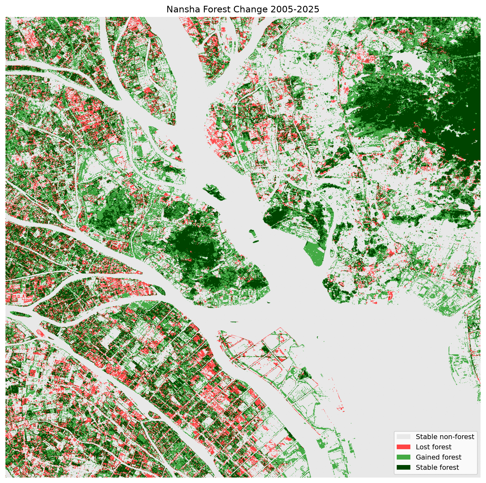
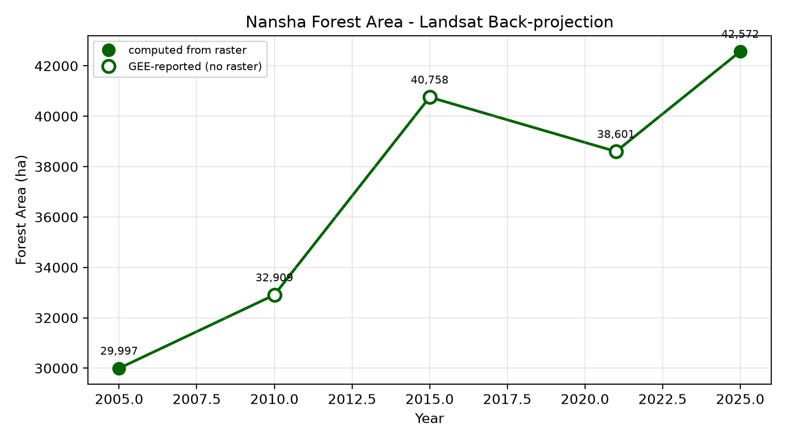

# Nansha Forest Change 2005–2025 (GEE)

A remote-sensing workflow exercise: train a random-forest forest classifier on ESA WorldCover 2021 labels, apply it to Landsat imagery from 2005–2025, and independently validate the back-projection with Dynamic World.

> **Purpose**: not a reliable forest inventory — it is a training exercise in running the full GEE → ML → back-projection → validation pipeline and understanding where it breaks.

---

## Research Question

How much tree cover did the Nansha study area gain or lose between 2005 and 2025, **and how reliable is that estimate when the training labels come from a present-day land-cover product?**

## Data

| Dataset | GEE ID | Resolution | Years | Use |
|---|---|---|---|---|
| ESA WorldCover v200 | `ESA/WorldCover/v200` | 10 m | 2021 | Training labels (class 10 = tree cover) |
| Landsat 5/7/8 C2 L2 | `LANDSAT/LT05\|LE07\|LC08/C02/T1_L2` | 30 m | 1984–present | Main time-series imagery |
| Dynamic World V1 | `GOOGLE/DYNAMICWORLD/V1` | 10 m | 2015–present | Independent validation (class 1 = trees) |

Study area: bounding box 113.43–113.77°E, 22.62–22.95°N (Nansha, Guangzhou and adjacent coastal/hilly terrain).

**Exported rasters.** The three GeoTIFFs that `analyze.py` consumes — `forest_2005.tif`, `forest_2025.tif`, `change_2005_2025.tif` — are committed under `data/` (~0.5 MB in total, EPSG:4326, 0.0002695° ≈ 30 m). They are the direct output of `gee/v3_validation_export.js` → Google Drive → `nansha_gis/`. Committing them makes the repository runnable after a clone; see `data/README.md`.

## Method

1. **Preprocessing** (`gee/v0_data_check.js`)
   - Landsat surface reflectance scaled: `DN × 0.0000275 − 0.2`
   - Cloud masking via `QA_PIXEL` bits 0–4 (fill, dilated cloud, cirrus, cloud, cloud shadow)
   - Annual median composite from all clear-sky observations in a year
   - L5/L7 band names (`SR_B1…B7`) kept separate from L8 (`SR_B2…B7`)

2. **Training** (`gee/v1_forest_classification.js`)
   - Labels: WorldCover class 10 → 1 (forest), all others → 0
   - Features: 6 reflectance bands + NDVI
   - `stratifiedSample`: 500 forest + 500 non-forest points at 30 m
   - Split: 70% train / 30% test (random, **not** spatial block split — see Limitations)
   - Classifier: `ee.Classifier.smileRandomForest(100)`

3. **Back-projection** (`gee/v2_backprojection.js`)
   - Apply the 2021-trained classifier to annual composites for 2005, 2010, 2015, 2021, 2025
   - Assumes the spectral signature of forest is stable across years and Landsat missions

4. **Independent validation + export** (`gee/v3_validation_export.js`)
   - Dynamic World annual mode composite for 2015 and 2025
   - Compare DW-derived net change with Landsat back-projected net change for the same period

### How areas are computed

Areas come from `ee.Image.pixelArea()` summed over the study grid (GEE scripts), i.e. each pixel's true ellipsoidal area, **not** a flat 30 m × 30 m = 900 m² cell. This matters: at 22.8°N a degree of longitude is only ~27.7 km, so a naive 900 m² cell would **overstate every area by about 9%**.

`analyze.py` re-derives the same areas locally from the exported rasters, correcting each raster row by its own `cos(latitude)`. It also prints the pixel area it actually used (≈826 m², not 900). The two routes agree to within ~0.5% — the local figure is a cross-check on the GEE output, not a replacement for it.

## Results

### Classification accuracy (2021, held-out test set) — from `gee/v1`

| Metric | Value |
|---|---|
| Overall Accuracy | 0.847 |
| Balanced Accuracy | 0.847 |
| Cohen's Kappa | 0.694 |

Confusion matrix (rows = observed, cols = predicted):
`[[125, 25], [22, 136]]`

### Forest area (back-projected, ha) — from `gee/v2`

| Year | Forest area (ha) | Images used |
|---|---|---|
| 2005 | 29,904 | 27 |
| 2010 | 32,909 | 17 |
| 2015 | 40,758 | 38 |
| 2021 | 38,601 | 32 |
| 2025 | 42,456 | 19 |

### 2005 → 2025 change — from `gee/v2` / recomputed in `analyze.py`

| Category | Area (ha) |
|---|---|
| Lost forest | 10,675 |
| Gained forest | 23,226 |
| Stable forest | 19,229 |
| **Net change** | **+12,552** |

### Independent validation (Dynamic World) — from `gee/v3`

| | 2015 | 2025 | Net change |
|---|---|---|---|
| Landsat back-projection | 40,758 ha | 42,456 ha | +1,698 ha |
| Dynamic World | 14,760 ha | 15,251 ha | +491 ha |

Both products agree on **direction** (net forest gain) but differ by ~3× in absolute area and magnitude of change — see Limitations.




## Limitations

1. **Labels are product outputs, not ground truth.** Training labels come from ESA WorldCover, itself a classifier. Reported accuracy measures agreement with WorldCover, not with on-the-ground forest.

2. **Back-projection assumption.** The classifier trained on 2021 Landsat 8 imagery is applied to 2005 Landsat 5/7 imagery. Sensor differences, radiometric calibration drift, and phenological shifts can be misread as forest change.

3. **Random (not spatial) train/test split.** Adjacent pixels are spectrally autocorrelated; a random split lets the model "see through" to nearby validation pixels, inflating accuracy. A spatial block split would give a more honest estimate of out-of-region generalisation.

4. **Landsat back-projection substantially overestimates forest area relative to Dynamic World** (≈40k ha vs ≈15k ha in 2015). Likely causes: WorldCover's "tree cover" definition is broader than DW's "trees", and 30 m mixed pixels inflate forest extent. The direction of change (both products show a modest net gain) is more trustworthy than the absolute numbers.

5. **Landsat 7 SLC-off** (post-2003 scan-line gaps) and low image count in 2010 (17 scenes) add noise to that year's estimate.

6. **Study area is a bounding box, not the administrative boundary.** It includes parts of Dongguan/Shenzhen hilly terrain and open water, so areas are not directly comparable to official Nansha statistics.

7. **The test set does not contain exactly 300 points.** 1,000 samples were split 70/30 at random rather than stratified, so the confusion matrix sums to 308, not 300. Minor, but it is a reason the accuracy figure is not exactly reproducible run-to-run.

## Reproduce

### GEE (Code Editor, JavaScript)

Scripts in `gee/` are ordered v0 → v3. Paste them into [code.earthengine.google.com](https://code.earthengine.google.com/) **cumulatively** — v1 depends on variables defined in v0, v2 on v1, v3 on v2 — and run once. v3 queues three exports; run them from the **Tasks** tab, then download the three GeoTIFFs into `data/`.

Note: `smileRandomForest` is seeded but still sensitive to library version, so a fresh run will not reproduce the figures above digit-for-digit.

### Local Python

From the repository root:

```
pip install rasterio numpy matplotlib
python analyze.py
```

Reads the three GeoTIFFs in `data/` and writes the figures to `figures/`. It prints the area table used above; the printed values agree with the GEE figures to within ~0.5%, and the script verifies that `forest_2005 ≈ stable + lost` and `forest_2025 ≈ stable + gained`.

## Project structure

```
nansha-forest-change-gee/
├── README.md
├── LICENSE                 # MIT
├── .gitignore
├── analyze.py              # local analysis of the exported rasters
├── gee/                    # GEE Code Editor scripts, run v0 -> v3 in order
│   ├── v0_data_check.js
│   ├── v1_forest_classification.js
│   ├── v2_backprojection.js
│   └── v3_validation_export.js
├── data/                   # exported GeoTIFFs + source notes
│   ├── README.md
│   ├── forest_2005.tif
│   ├── forest_2025.tif
│   └── change_2005_2025.tif
└── figures/                # output maps and charts
    ├── change_map.png
    └── forest_trend.png
```
